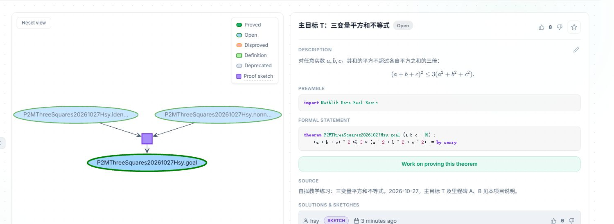
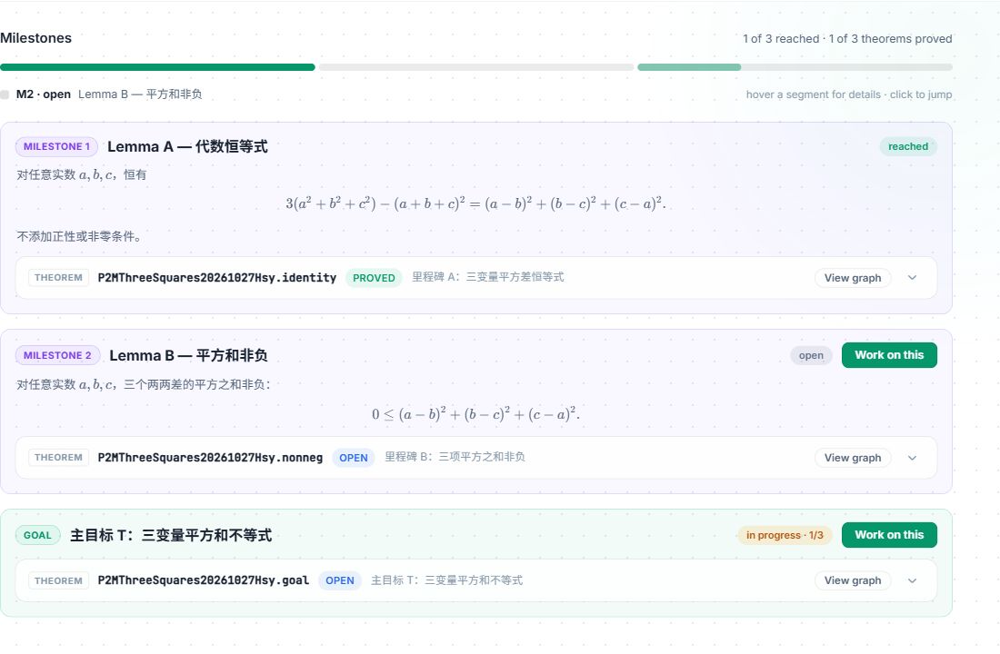
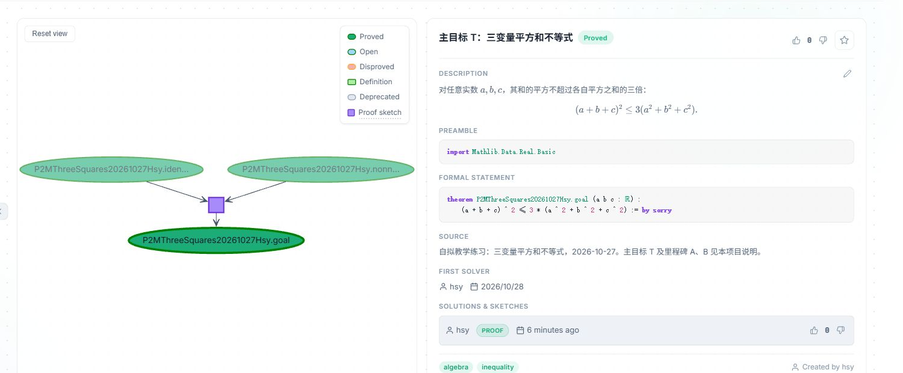

# 试用演示

**[观看／下载完整录屏：2分46秒，MP4](videos/prove2me-demo.mp4)**。视频已随本目录保存；以下三张截图展示关键过程。

## 证明什么

对任意实数 $a,b,c$，证明：

$$T:\quad (a+b+c)^2\leq3(a^2+b^2+c^2).$$

A 将“右侧减左侧”改写成平方和，B 证明该平方和非负，外层归约用 A、B 推出 T。[数学思路与 Lean 代码](01-prove2me简介.md#结合例子看)

本次由 Codex 起草、证明与提交，独立 Agent 回译声明，用户授权 Codex 代核对；Prove2Me 验证并更新依赖。

## 看清状态变化

### 草图通过，仍待补证

在 Graph 中，A、B 已经通过草图连到 T，但三个命题仍待证；右侧提交显示 **SKETCH**。

### 只完成 A

提交 A 的证明后，Milestones 显示 A 为 **Proved**，B、T 仍为 **Open**。

### 补齐 B，T 自动完成

B 的证明通过后，A、B、T 全部 **Proved**；原外层提交由 **SKETCH** 变为 **PROOF**，没有另交 T 的直接证明。

A、B 可以并行求解；演示按顺序上传，用来观察中间状态。`Open` 表示平台上尚待证明。
